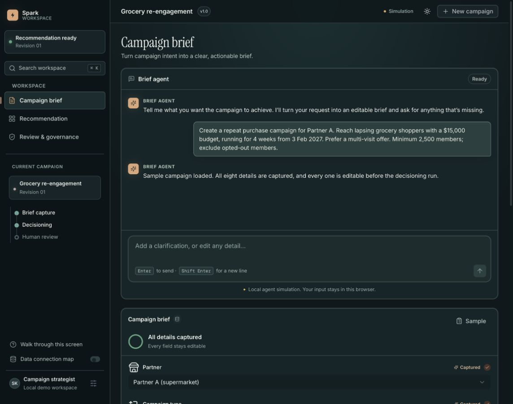
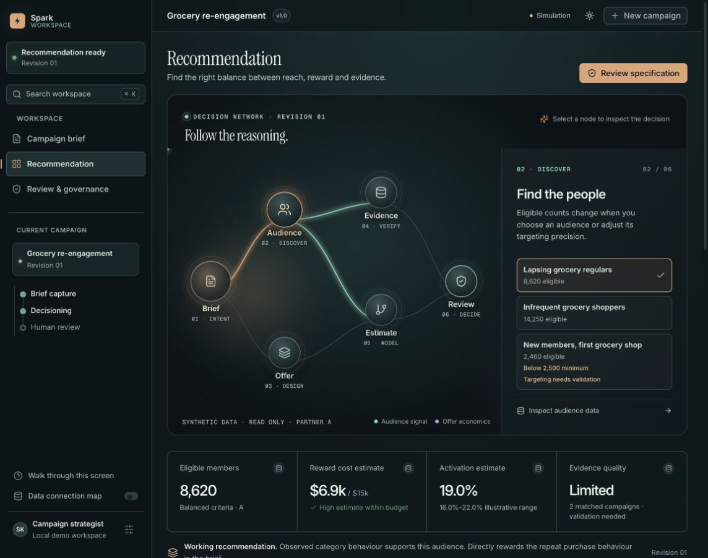
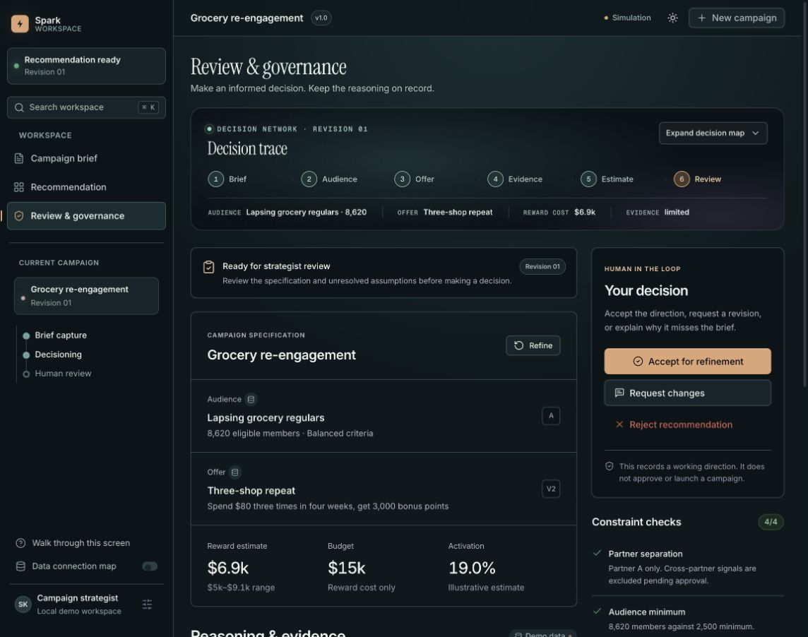

<div align="center">

# Spark · Campaign Intelligence

**A front-end proof of concept for turning a loyalty-campaign brief into an evidenced recommendation — with a human decision at the end of it.**

[](https://github.com/Sheheryargit/frontend/actions/workflows/ci.yml)
&nbsp;·&nbsp; React 18 &nbsp;·&nbsp; TypeScript 5.9 &nbsp;·&nbsp; Vite 7 &nbsp;·&nbsp; Tailwind 4 &nbsp;·&nbsp; Motion 14

</div>



---

## What this is

A campaign strategist describes a campaign in plain language. A local scripted agent structures it
into eight editable details, pauses for review, then runs a cancellable decisioning pass over
synthetic data. The recommendation can be compared, questioned, accepted for refinement, revised
or rejected by a human.

**It is a demonstration of an interaction model, not a product.** Every figure is synthetic,
nothing is written back to any system, and the "agent" is a scripted local adapter. The
interesting part is the *honesty machinery*: the UI is built so that a value the agent is
unsure about cannot be mistaken for one it is confident in, and a missing value can never be
read as a zero.

### The three screens

| Screen | What happens |
|---|---|
| **Campaign brief** | Conversational capture, editable fields and a live audience/budget viability preflight |
| **Recommendation** | Decision network, reusable segment recipes, interactive reach/cost scenarios, evidence passport and contextual questions |
| **Review & governance** | Visible human decision, constraint checks, review packet export, local validation tasks and a POC scorecard |

<table>
<tr>
<td width="50%"></td>
<td width="50%"></td>
</tr>
<tr>
<td align="center"><em>Recommendation</em></td>
<td align="center"><em>Review &amp; governance</em></td>
</tr>
</table>

---

## Quickstart

Requires **Node 26**. See [`.nvmrc`](.nvmrc).

```bash
npm install
npm run dev
```

Open <http://127.0.0.1:5173>. No API keys or backend are required. Campaign data and task
preferences stay in this browser's `localStorage`. The optional Google Fonts stylesheet needs
network access; system fallbacks are provided.

| Script | Does |
|---|---|
| `npm run dev` | Vite dev server with HMR |
| `npm run build` | `tsc -b` then a production build |
| `npm run preview` | Serve the production build |
| `npm run typecheck` | Types only, no emit |
| `npm test` | Vitest UI and geometry checks |
| `npm run test:watch` | Re-run tests during development |

---

## Documentation

| Document | Covers |
|---|---|
| [`AGENTS.md`](AGENTS.md) | Portable rules for any coding agent or editor |
| [`docs/ARCHITECTURE.md`](docs/ARCHITECTURE.md) | Module boundaries, state, data flow and integration path |
| [`docs/DESIGN.md`](docs/DESIGN.md) | Current visual identity, motion and component standards |
| [`docs/AGENT.md`](docs/AGENT.md) | Simulated agent, event contracts and backend connection path |
| [`docs/DECISIONS.md`](docs/DECISIONS.md) | Why the product behaves the way it does — the rules that must not be broken |
| [`docs/design-sources.md`](docs/design-sources.md) | Open-source library and interaction references |
| [`CONTRIBUTING.md`](CONTRIBUTING.md) | Local setup, conventions, review expectations |

---

## Design principles

These are load-bearing. Changing the UI without honouring them changes what the product claims.

1. **Absence is never zero.** A missing figure renders as the word *Missing*, exports as
   `MISSING`, and is styled grey — never red, never `0`, never an empty cell.
2. **Captured is not the same as usable.** A value can be present and still out of scope. The
   brief board has three states — *ready*, *to check*, *missing* — and amber carries a stated
   reason.
3. **Precision survives to the decision.** Money is formatted in exact dollars wherever it is
   compared against a budget ceiling. Compact notation (`$8.6k`) is confined to chart axis ticks.
4. **Three-point estimates keep their range.** Low–central–high is never collapsed to a single
   number in a surface that drives a decision.
5. **Accepting is not launching.** The product records a working direction. It does not approve,
   schedule or activate anything, and the UI says so at the point of decision.
6. **Motion is state, not decoration.** Every animation reports something real; anything purely
   ornamental is gated behind `prefers-reduced-motion`.
7. **A question does not imply a connected agent.** Ask Spark uses a local scripted response
adapter. The decisioning run has ten visible substeps across five stages, all labelled as a
   simulation. Service interfaces are kept separate from the React screens for later replacement.

---

## Status and limitations

- Scope is **Partner A, repeat purchase**. Other partners and campaign types are deliberately
  refused with an explanation rather than estimated.
- The audience universe is **50,000 synthetic members**; counts are illustrative and no query
  is executed.
- Costing, comparator quality and confidence thresholds are **unvalidated assumptions**
  pending stakeholder sign-off.
- There is no authentication, no authorisation and no partner isolation. Those belong in a
  backend that does not yet exist.

---

## Licence and attribution

Source in this repository is MIT licensed — see [`LICENSE`](LICENSE).

UI primitives are derived from [shadcn/ui](https://ui.shadcn.com) (MIT); its licence is retained
in [`SHADCN-LICENSE`](SHADCN-LICENSE). Icons are [Lucide](https://lucide.dev) (ISC).
